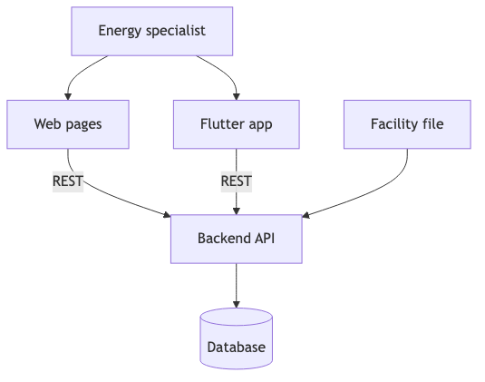
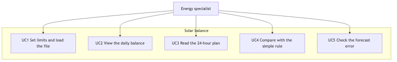
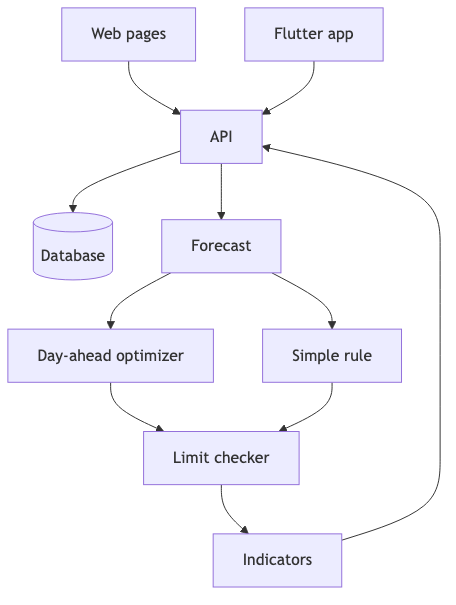

# 7. Architecture

**Owner:** Oralov Alinur.

Components are a draft and are not deployed.

The system advises one industrial site. A web page and a Flutter application call one backend. The backend forecasts the next 24 hours, runs the optimizer and the simple rule, and stores both plans. It does not connect to inverters.

## 7.1 Context

*Figure 7.1. System context. Both clients call the same API. The software does not command equipment.*

Editable source: [diagrams/context.mmd](../diagrams/context.mmd).

The energy specialist uses the web pages and, at the final milestone, the Flutter application. Both send the facility file and the battery limits to the backend and read the plan back. PostgreSQL stores the file, the limits, the forecasts, and the two plans. Nginx forwards the requests. Docker Compose runs the API, the database, and nginx.

## 7.2 Use cases

*Figure 7.2. Use cases. UC4 is the simple rule. UC5 is the forecast-error screen.*

Editable source: [diagrams/use-case.mmd](../diagrams/use-case.mmd).

*Table 7.1. Use cases.*

| ID | Name | Prototype |
| --- | --- | --- |
| UC1 | Set limits and load the file | Scenario 1, data and limits |
| UC2 | View the daily balance | Scenario 2 |
| UC3 | Read the 24-hour plan | Scenario 3 |
| UC4 | Compare with the simple rule | The switch on the 24-hour plan, and the cycle-limit warning |
| UC5 | Check the forecast error | Scenario 4 |

*Note. UC4 does not compare the plan with a battery that is left idle. Accepting or rejecting the plan does not send a command.*

## 7.3 Draft components

*Figure 7.3. Draft components. The simple rule is separate from the optimizer.*

Editable source: [diagrams/component.mmd](../diagrams/component.mmd).

*Table 7.2. Draft components.*

| Component | Responsibility |
| --- | --- |
| Web pages | HTML, CSS, and JavaScript for the four screens. They do not forecast or optimize. |
| Flutter application | The same four screens at the final milestone. It does not contain a second calculation. |
| API | FastAPI. Validates the file, stores the run, and returns both plans. It does not talk to an inverter. |
| Database | PostgreSQL tables for the file, the limits, the forecasts, and the hourly rows. |
| Forecast | Gradient boosting and the same-as-yesterday series, each with 24 values. |
| Day-ahead optimizer | The main 24-hour plan and one reason per hour. It keeps the daily cycle limit. |
| Simple rule | The baseline on the same forecast. It does not share variables with the optimizer. |
| Limit checker | Replays state of charge and equivalent cycles. Marks the simple rule when it exceeds the cycle limit. It does not repair a row silently. |
| Indicators | The six indicators in the proposal, for both calculations. |

Data move from either client to the API, then to the database and the forecast. The forecast feeds the optimizer and the simple rule. Both results pass the limit checker and the indicators, and return through the API. The simple rule is never stored under the optimizer’s name.
